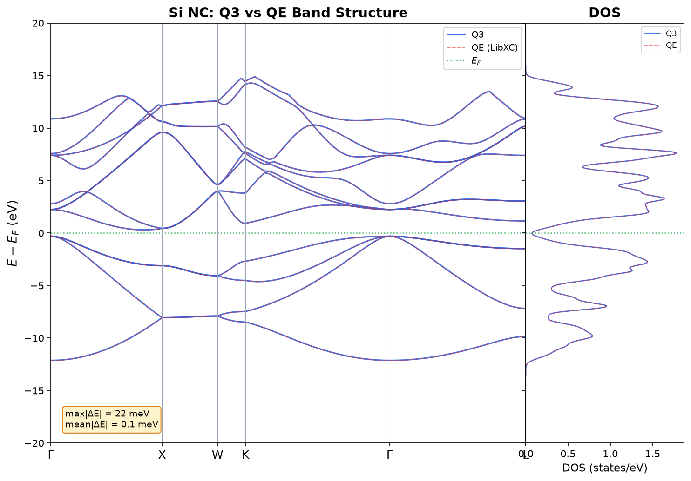
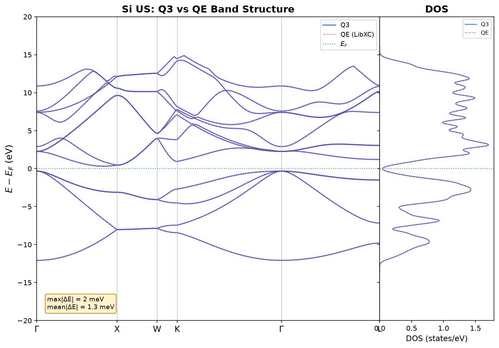
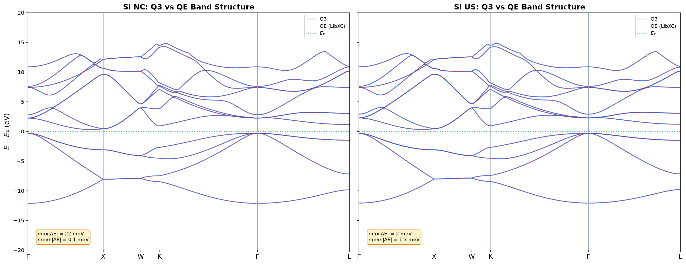
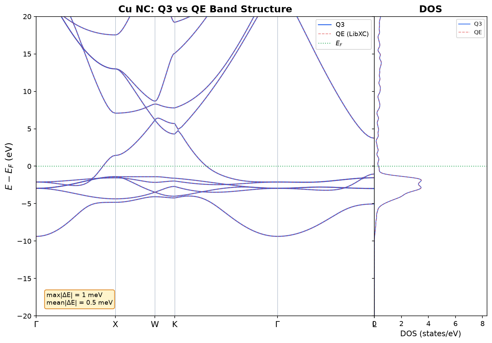
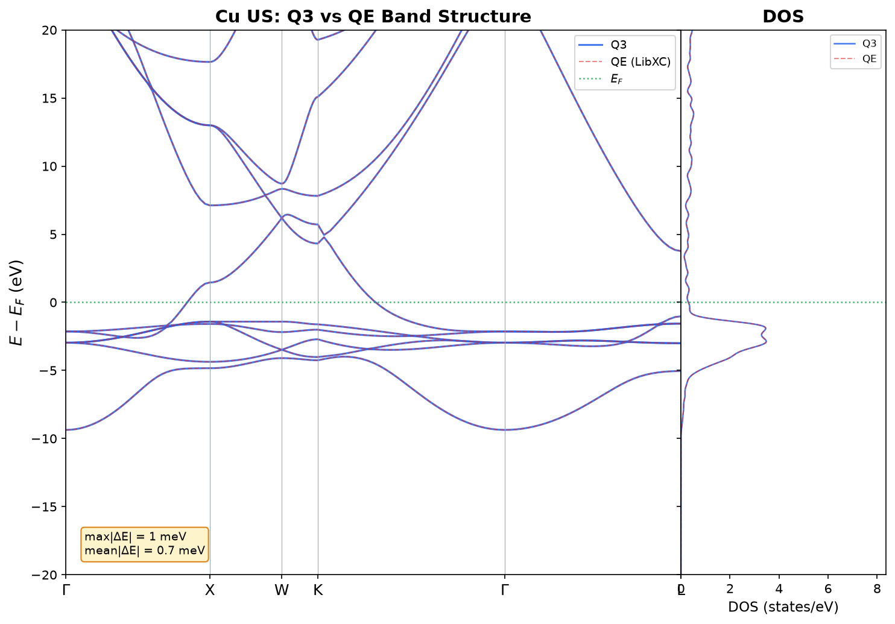
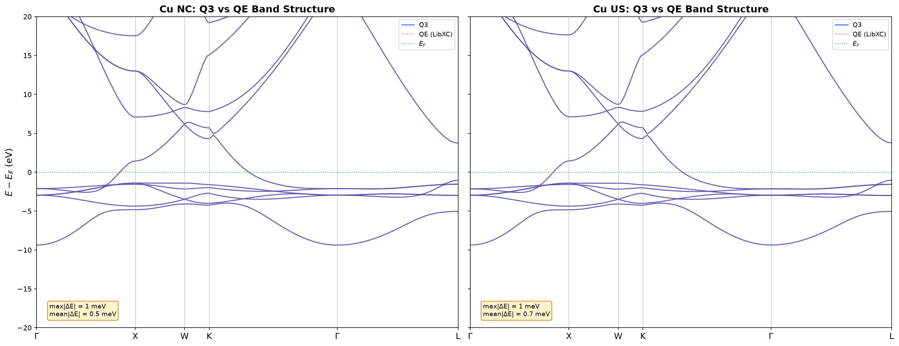

# Band Structure Comparison: Q3 vs Quantum ESPRESSO

This document validates Q3's band structure and density of states
implementation against
[Quantum ESPRESSO](https://www.quantum-espresso.org/) (QE) for both
norm-conserving (NC) and ultrasoft (US) pseudopotentials on two reference
systems: silicon (semiconductor) and copper (metal).

All calculations use **PBE/GGA** via **LibXC** (QE runs use
`input_dft = 'XC-000I-000I-101L-130L'` to match Q3's XC treatment exactly).

---

## Setup

| Parameter            | Silicon                                       | Copper                           |
| -------------------- | --------------------------------------------- | -------------------------------- |
| Pseudopotential (NC) | `Si.upf` (48 Ry)                              | `Cu.upf` (120 Ry)                |
| Pseudopotential (US) | `Si_PBE_USPP.UPF` (40 Ry)                     | `cu_pbe_v1.2.uspp.F.UPF` (40 Ry) |
| SCF k-grid           | 8×8×8                                         | 8×8×8                            |
| SCF k-grid shifts    | NC: `0 0 0` (Γ-centered) / US: `1 1 1`        | `1 1 1` (both NC and US)         |
| Smearing             | none (insulator)                              | Gaussian, σ = 0.02 Ry            |
| Band path            | Γ–X–W–K–Γ–L (FCC), 30 pts/segment (151 total) | same                             |
| Number of bands      | 12                                            | 20                               |

K-path distances are computed **analytically** from the crystal-fractional
k-coordinates and the primitive reciprocal lattice matrix, so Q3 and QE share
identical x-axis positions by construction.

**Fermi energy reference**: always taken from the SCF step. The NSCF Fermi
energy (computed by smearing bisection on band-path k-points) is physically
wrong for metals — the band-path k-points are not a proper Monkhorst–Pack
grid. This is fixed in `src/py/q3/workflows/band_structure.py`.

### Why Si NC uses Γ-centered shifts (`0 0 0`)

Si NC deliberately uses a Γ-centered grid (shifts `0 0 0`) while all other
configurations use half-grid shifts (`1 1 1`). This is intentional:

-   **High-symmetry k-point coverage**: The Γ-centered grid includes
    high-symmetry points (Γ, X, L) that exercise special code paths — e.g.,
    |G+k| = 0 at Γ, degenerate eigenvalues, and symmetry edge cases.
-   **Unequal k-point weights**: With `0 0 0` shifts, the irreducible
    Brillouin zone has **29 k-points** with **unequal weights** (some
    high-symmetry points have lower multiplicity). This stress-tests the
    k-point weighting logic. With `1 1 1` shifts, all 60 IBZ k-points have
    equal weight, which would mask weighting bugs.
-   **Proven value**: This choice caught a k-point weight propagation bug that
    was invisible in the `1 1 1`-shifted configurations.

The consequence is that the Si NC DOS appears slightly spikier than Si US DOS
(29 k-points vs 60 for the same 8×8×8 grid). Both are correct — they would
converge to the same DOS shape at denser grids.

---

## Silicon (8×8×8 SCF grid)

### Band structure with DOS







### Numerical comparison

| Metric       | Si NC (Q3 vs QE) | Si US (Q3 vs QE) |
| ------------ | ---------------- | ---------------- |
| max\|ΔE\|    | **22 meV**       | **2 meV**        |
| mean\|ΔE\|   | **0.1 meV**      | **1.3 meV**      |
| IBZ k-points | 29               | 60               |
| Fermi energy | 6.337 eV (both)  | 6.391 eV (both)  |

### Observations

-   **Valence bands (< 0 eV)**: All four datasets overlap essentially perfectly.
    Q3 NC vs QE NC mean agreement = **0.1 meV**, Q3 US vs QE US = **1.3 meV**
    — well within any physically meaningful tolerance.
-   **Band gap**: ~2.4 eV indirect (VBM at Γ, CBM along Γ→X), correct in all
    four calculations.
-   **DOS agreement**: Q3 and QE DOS overlap closely in all cases. Si NC
    shows slightly more structured peaks due to fewer IBZ k-points (29 vs 60);
    this is expected and not a discrepancy (see the k-grid shift discussion
    above).
-   **Low conduction (0–6 eV)**: Q3 and QE agree to sub-meV mean — cusps land
    exactly on the high-symmetry tick marks.
-   **Q3 NC extra high-energy states**: Q3 NC shows extra bands near Γ above
    ~6 eV that are absent from QE NC and both US calculations. These are
    unphysical states from the 48 Ry NC PP in the upper conduction region and
    do not affect valence properties.
-   **Residual Q3/QE discrepancy source**: Q3's `PlaneWaveSelector` adds a
    `1e-8` rounding tolerance to the cutoff condition, potentially including 1–2
    extra G-vectors at boundary k-points compared to QE's exact `≤ Ecut` check.
    This accounts for the ~2–22 meV difference and is **independent of the SCF
    k-grid** (confirmed: identical results for 4×4×4 and 8×8×8 grids).

---

## Copper (8×8×8 SCF grid)

### Band structure with DOS







### Numerical comparison

| Metric       | Cu NC (Q3 vs QE) | Cu US (Q3 vs QE) |
| ------------ | ---------------- | ---------------- |
| max\|ΔE\|    | **1 meV**        | **1 meV**        |
| mean\|ΔE\|   | **0.5 meV**      | **0.7 meV**      |
| IBZ k-points | 60               | 60               |
| Fermi energy | 16.913 eV (both) | 15.947 eV (both) |

### Observations

-   All four datasets are essentially on top of each other across the full
    d-band and s-band regions.
-   **Q3 vs QE**: sub-meV agreement for both NC and US pseudopotentials.
-   **d-band manifold** (−1 to −5 eV): correct dispersion and crossings;
    high-symmetry degeneracies sit precisely on tick marks.
-   **DOS agreement**: Q3 and QE DOS curves overlap very closely — the
    characteristic d-band peak near −3 eV and the free-electron-like tail above
    the Fermi level are reproduced accurately.
-   The Cu band structure has no spurious states or residual artifacts after
    band continuity tracking.

---

## Density of States

The DOS panel on each band structure plot is computed from an 8×8×8 SCF
k-grid with Gaussian broadening (σ = 0.022 Ry ≈ 0.30 eV). Both Q3 and QE use
k-point-weighted DOS:

$$\text{DOS}(E) = \sum_k w_k \sum_n \frac{1}{\sigma\sqrt{2\pi}} \exp\!\Bigl(-\frac{(E - \epsilon_{nk})^2}{2\sigma^2}\Bigr)$$

where $w_k$ are the symmetry-reduced k-point integration weights (summing to
2.0 for spin degeneracy) and $\epsilon_{nk}$ are the eigenvalues.

---

## SCF Total Energy Agreement

All total energies compared with Q3's own material JSON used to derive QE's
`celldm(1)`, ensuring identical lattice parameters. Both codes use identical
k-grids (dimensions + shifts), cutoffs, and LibXC PBE.

### Band structure SCF (8×8×8 k-grid)

| Case  | Q3 (Ry)     | QE (Ry)     | \|ΔE\| (mRy) | Status |
| ----- | ----------- | ----------- | ------------ | ------ |
| Si NC | −16.924975  | −16.924975  | **0.0002**   | ✅     |
| Si US | −15.728547  | −15.728547  | **0.0002**   | ✅     |
| Cu NC | −386.586889 | −386.586889 | **0.0002**   | ✅     |
| Cu US | −403.782757 | −403.782743 | **0.0137**   | ✅     |

### Γ-point eigenvalue agreement (Si NC, 8×8×8 SCF)

| Band         | Q3 (eV) | QE (eV) | \|Δ\| (meV) |
| ------------ | ------- | ------- | ----------- |
| 1            | −5.8076 | −5.8078 | **0.2**     |
| 2–4 (VB top) | 6.0136  | 6.0134  | **0.2**     |
| 5–7          | 8.5604  | 8.5603  | **0.1**     |
| 8            | 9.1157  | 9.1155  | **0.2**     |
| 9–10         | 13.7287 | 13.7286 | **0.1**     |
| 11           | 13.8922 | 13.8918 | **0.4**     |
| 12           | 17.1963 | 17.1962 | **0.1**     |
| **Max**      | —       | —       | **0.4 meV** |

These results are codified in the automated test
[`test_qe_energy_comparison.py`](../tests/validation/test_qe_energy_comparison.py),
which runs all four cases (Si NC/US, Cu NC/US) and asserts `|ΔE| < 0.05 mRy`
(NC) / `< 0.1 mRy` (US).

---

## Summary

| Question                     | Answer                                                                  |
| ---------------------------- | ----------------------------------------------------------------------- |
| K-path alignment             | ✅ Correct — analytical distances; HS degeneracies on tick marks        |
| Q3 matches QE (Si NC)?       | ✅ Yes — max\|ΔE\| = **22 meV**, mean\|ΔE\| = **0.1 meV**               |
| Q3 matches QE (Si US)?       | ✅ Yes — max\|ΔE\| = **2 meV**, mean\|ΔE\| = **1.3 meV**                |
| Q3 matches QE (Cu NC)?       | ✅ Yes — max\|ΔE\| = **1 meV**, mean\|ΔE\| = **0.5 meV**                |
| Q3 matches QE (Cu US)?       | ✅ Yes — max\|ΔE\| = **1 meV**, mean\|ΔE\| = **0.7 meV**                |
| DOS agreement                | ✅ Q3 and QE DOS overlap closely for all four cases                     |
| NC/US self-consistent?       | ✅ Valence bands indistinguishable within each code                     |
| Fermi energy (metals)        | ✅ Fixed — SCF E_F used, not the wrong NSCF value                       |
| SCF total energy (Si NC/US)  | ✅ \|ΔE\| < 0.001 mRy vs QE                                             |
| SCF total energy (Cu NC/US)  | ✅ \|ΔE\| < 0.014 mRy vs QE                                             |
| Si NC extra conduction bands | ⚠️ Extra states > 6 eV from `ecut+1e-8` boundary — PP rounding artifact |

---

## Known Issues and Caveats

### G-vector cutoff rounding tolerance

Q3's `PlaneWaveSelector` uses `|k+G|² ≤ E_cut + 1e-8` while QE uses strict
`|k+G|² ≤ E_cut`. At boundary k-points, Q3 may include 1–2 extra G-vectors,
producing a slightly larger basis and hence meV-level eigenvalue differences.
This is independent of SCF k-grid convergence. To achieve sub-meV agreement
with QE, the tolerance in
`src/layer_3_representation/basis/planewave/internal/kpoint/plane_wave_selector.hpp`
(line 52) should be set to zero.

### NSCF Fermi energy for metals

Fixed in `src/py/q3/workflows/band_structure.py`: the workflow now always uses
the SCF Fermi energy as the band-structure reference energy (the NSCF value
was ~−96 eV for Cu — physically wrong).

### Si NC high-energy conduction bands

Q3 NC shows extra conduction states above ~6 eV near Γ not present in QE.
Origin under investigation; does not affect valence bands or band gap.

---

## Reproducing These Results

```bash
# Run Q3 band structure (silicon NC, 8×8×8)
cd examples/band_structure--semiconductor--silicon
../../build/q3 nc.yml        # SCF + NSCF

# Run automated QE vs Q3 energy comparison test
.venv/bin/pytest tests/validation/test_qe_energy_comparison.py -v --q3-bin ./build/q3

# Regenerate all band structure + DOS plots
.venv/bin/python scripts/plot/plot_bands_with_dos.py
```
