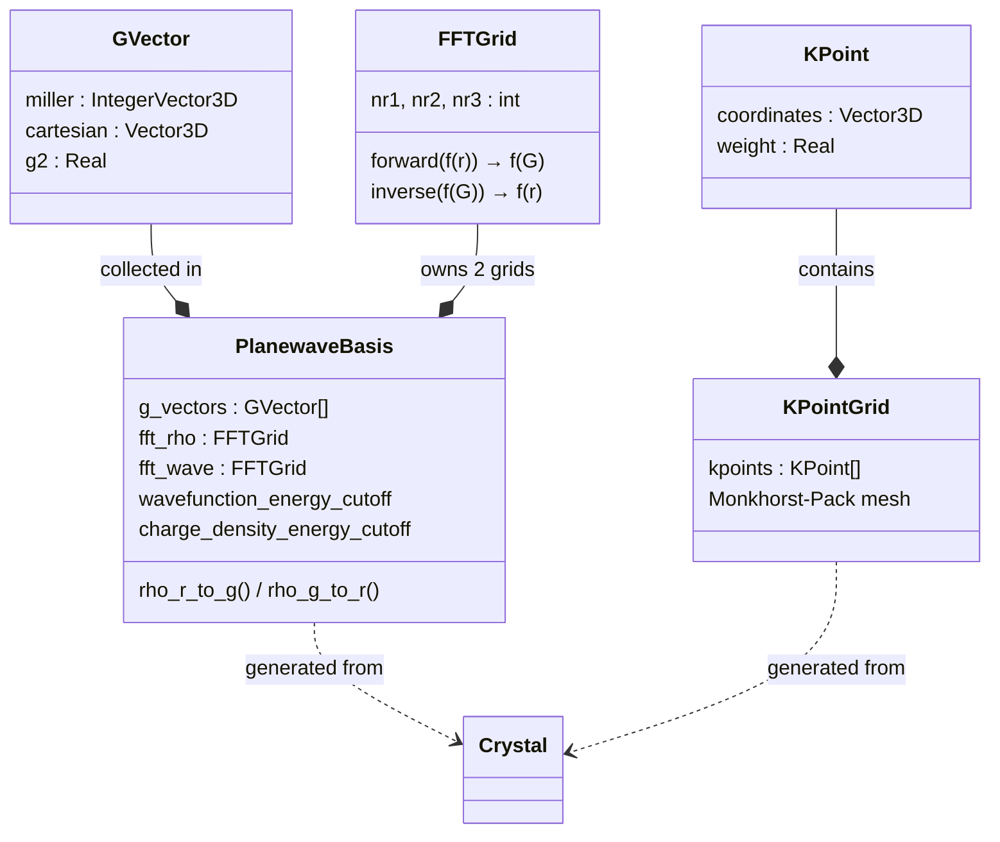
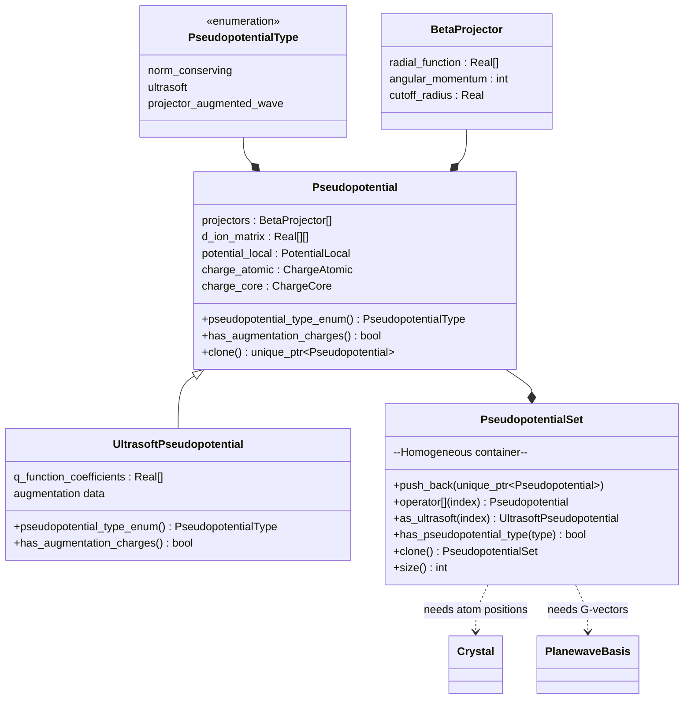
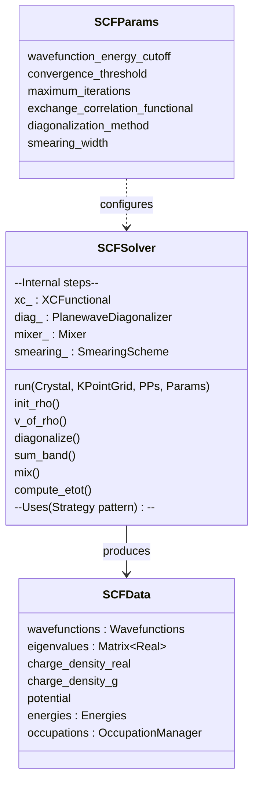
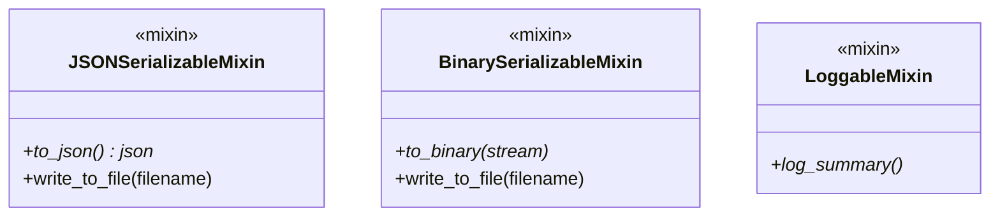
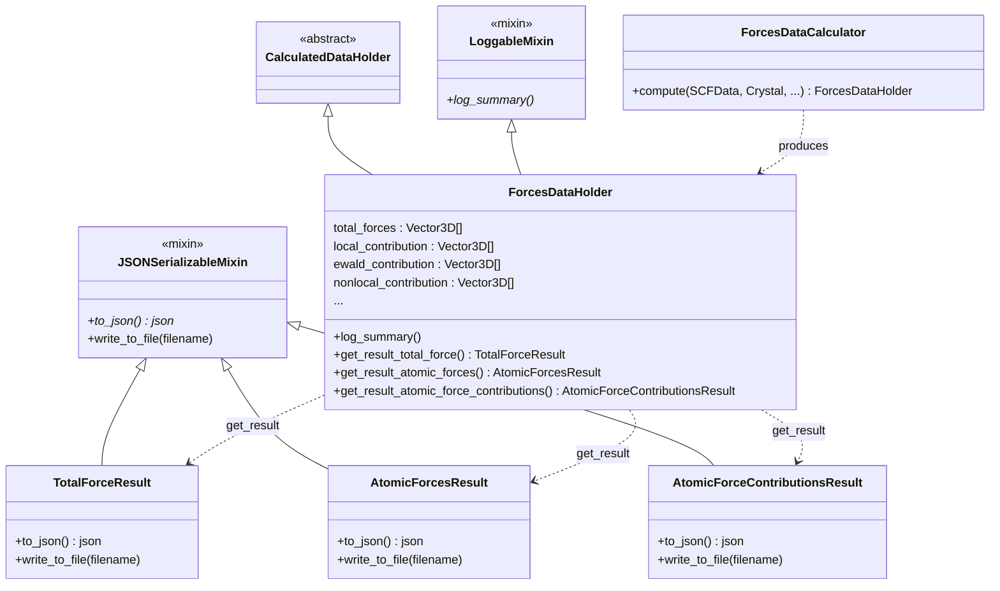

# Q3 Data Model Ontology

This document defines the conceptual layers, entities, and relationships in the Q3 DFT codebase. Each layer maps to a `src/layer_N_*` directory and may only depend on layers below it — never sideways or upward. The IO slice (`src/io/`) can reach into any layer.

The visual diagram is in [ontology.drawio](ontology.drawio).

> **Status note (2026-07-08):** this document mixes two kinds of content: concrete
> class hierarchies (kept in sync with the code) and the conceptual
> DataHolder / DataCalculator / Result design pattern, whose class names
> (`ForcesDataHolder`, `AtomicForcesResult`, `LoggableMixin`, …) describe design
> intent and have **diverged from the implementation** — results are produced via
> `FlavorResult` and per-property structs in `layer_5_properties/*/contributions.hpp`
> plus generated ESSE types. A full reconciliation pass, including
> [ontology.drawio](ontology.drawio), is tracked in [TODOs.md](../TODOs.md) §3.5.
> For the authoritative per-file map, see [architecture.md](architecture.md).

---

## Layer 0: Core (`src/layer_0_core/`)

Foundation types with no physics knowledge.

| Type              | Description                | Used For                                            |
| ----------------- | -------------------------- | --------------------------------------------------- |
| `Real`            | `double` scalar            | Energies (Ry), lengths (Bohr), cutoffs              |
| `Complex`         | `std::complex<double>`     | Fourier coefficients ψ(G), ρ(G), V(G)               |
| `Vector3D`        | 3-component real vector    | Atomic positions, k-points, forces, lattice vectors |
| `IntegerVector3D` | 3-component integer vector | Miller indices (h,k,l), FFT grid indices            |
| `Matrix3x3`       | 3×3 real matrix            | Lattice vectors, rotation matrices, stress          |
| `Matrix<T>`       | Dense NxM template         | Eigenvalues [nk×nbnd], D-matrices [nh×nh]           |

---

## Layer 1: Structure (`src/layer_1_structure/`)

Physical description of the periodic system — no knowledge of electronic structure.

```mermaid
classDiagram
    class AtomSpecies {
        symbol : string
        mass : Real
        atomic_number : int
    }
    class Atom {
        species : AtomSpecies
        position : Vector3D
        (fractional coordinates)
    }
    class Crystal {
        lattice_vectors : Matrix3x3
        reciprocal_lattice_vectors : Matrix3x3
        atoms : Atom[]
        lattice_parameter : Real
        cell_volume : Real
        two_pi_over_alat : Real
    }
    class SymmetryOperation {
        rotation : Matrix3x3
        translation : Vector3D
    }
    class SymmetryAnalyzer {
        find_operations(Crystal)
        spglib wrapper
    }
    AtomSpecies --* Atom : has
    Atom --* Crystal : contains
    SymmetryOperation --* SymmetryAnalyzer : produces
    SymmetryAnalyzer ..> Crystal : analyzes
```

**Key relationships:**

-   `Crystal` **owns** a collection of `Atom`s
-   `Atom` **contains** an `AtomSpecies` (element identity)
-   `SymmetryAnalyzer` **reads** a `Crystal` to find its `SymmetryOperation`s
-   `Crystal` stores both direct and reciprocal lattice vectors

---

## Basis & Reciprocal Space (`src/layer_3_representation/basis/`, `src/layer_1_structure/reciprocal_space/`)

The mathematical framework for expanding wavefunctions and densities.
(`GVector`, `FFTGrid`, and `PlanewaveBasis` live in `layer_3_representation/basis/planewave/`;
`KPoint` and `KPointGrid` in `layer_1_structure/reciprocal_space/`. The abstract
quantum-system concepts themselves are in `src/layer_2_quantum_system/`.)



**Key relationships:**

-   `PlanewaveBasis` **owns** all `GVector`s satisfying the energy cutoff
-   `PlanewaveBasis` **owns** two `FFTGrid`s: one for wavefunctions (ecutwfc), one for density (ecutrho, typically 4× larger)
-   `PlanewaveBasis` is **generated from** the `Crystal`'s reciprocal lattice
-   `KPointGrid` is **generated from** the `Crystal`'s symmetry (Monkhorst-Pack + symmetry reduction)

**Why two cutoffs?** Wavefunctions ψ need G-vectors up to `ecutwfc`, but ρ = |ψ|² has Fourier components up to 2×G_max, requiring `ecutrho ≥ 4 × ecutwfc`.

---

## Layer 3: Representation — Pseudopotentials (`src/layer_3_representation/`)

Atomic physics input — replaces core electrons with effective potentials.



**Key relationships:**

-   `PseudopotentialSet` is a **homogeneous polymorphic container** — all entries must be the same concrete type (NC, ultrasoft, or PAW)
-   `as_ultrasoft(index)` provides **typed access** without runtime type-checking — the factory guarantees homogeneity at construction time
-   `Pseudopotential` uses a `PseudopotentialType` enum (not boolean flags) for type classification
-   During initialization, PP data is **tabulated in G-space** using the `PlanewaveBasis`
-   At each k-point, Kleinman-Bylander projectors β(k+G) are **computed on demand**
-   The effective D-matrix (deeq) is **recomputed each SCF iteration** from the current potential

---

## Layer 3: Representation — Quantum State Objects (`src/layer_3_representation/`)

The central physical quantities in Kohn-Sham DFT. These are what the SCF cycle computes.

| Object                       | Representation       | Formula                                  | Stored As                |
| ---------------------------- | -------------------- | ---------------------------------------- | ------------------------ |
| **Wavefunctions** ψ\_{nk}(G) | PW coefficients      | Solutions of Hψ = εψ                     | `Complex[nk][nbnd][npw]` |
| **Charge Density** ρ(r)      | Real-space grid      | ρ = Σ*{nk} f*{nk} \|ψ\_{nk}(r)\|²        | `Real[nspin][Nr]`        |
| **Charge Density** ρ(G)      | Reciprocal space     | FFT[ρ(r)]                                | `Complex[Ng]`            |
| **Effective Potential** V(r) | Real-space grid      | V = V_H[ρ] + V_xc[ρ] + V_loc             | `Real[nspin][Nr]`        |
| **Eigenvalues** ε\_{nk}      | Per band per k-point | From diagonalization                     | `Real[nk][nbnd]`         |
| **Occupations** f\_{nk}      | Per band per k-point | From smearing(ε, E_F)                    | `Real[nk][nbnd]`         |
| **Energies**                 | Scalar components    | E_tot = E_band + E_H + E_xc + E_ew + ... | `Energies` struct        |

### The SCF Cycle (data flow)

```
                    ┌─────────────┐
                    │  ρ_in(r,G)  │ ← initial: superposition of atomic charges
                    └──────┬──────┘
                           │ v_of_rho()
                           ▼
                    ┌─────────────┐
                    │   V_eff(r)  │ V_H(ρ) + V_xc(ρ) + V_loc + V_NL
                    └──────┬──────┘
                           │ diagonalize()
                           ▼
              ┌────────────────────────┐
              │  ψ_{nk}(G), ε_{nk}    │  Kohn-Sham eigenvalue problem
              └────────────┬───────────┘
                           │ smearing()
                           ▼
                    ┌─────────────┐
                    │  f_{nk}     │  Occupation numbers
                    └──────┬──────┘
                           │ sum_band()
                           ▼
                    ┌─────────────┐
                    │  ρ_out(r)   │ = Σ f_{nk} |ψ_{nk}(r)|²
                    └──────┬──────┘
                           │ mix()
                           ▼
                    ┌─────────────┐
               ┌──▶│  ρ_new(G)   │  Broyden/Anderson mixing
               │   └──────┬──────┘
               │          │ converged?
               │    ┌─────┴─────┐
               │    │ NO        │ YES → SCFData (snapshot)
               │    ▼           ▼
               └──ρ_in      Output
```

---

## Layer 4: Computation — Strategies (`src/layer_4_computation/`)

Pluggable algorithms (Strategy pattern). Each is an abstract base class with concrete implementations.

### XC Functional: ρ → V_xc, ε_xc

Maps charge density to exchange-correlation potential and energy density.

```
XCFunctional (abstract)
└── XC_LibXC               — PIMPL wrapper over LibXC, 600+ functionals (LDA/GGA)
```

All functionals go through LibXC; named functionals (PZ, PBE, PBEsol, BLYP, revPBE)
map to LibXC IDs in `XCFunctionalFactory`. GGA functionals report
`requires_density_gradient()` and implement `compute_gradient_corrected(ρ, |∇ρ|²)`.
Meta-GGA is planned (see [TODOs.md](../TODOs.md) §1.2).

### Diagonalizer: V_eff → ψ, ε

Solves the Kohn-Sham eigenvalue problem H·ψ = ε·S·ψ at one k-point.

```
PlanewaveDiagonalizer (abstract)
├── PlanewaveDirectDiagonalizer    — LAPACK zheev/zhegv, O(npw³), exact
└── PlanewaveDavidsonDiagonalizer  — Iterative, O(npw·nbnd), for large systems
```

### Charge Density Mixer: (ρ_in, ρ_out) → ρ_new

Accelerates SCF convergence by mixing input and output densities.

```
Mixer (abstract)
├── RealSpaceMixer (abstract)
│   └── AndersonMixer      — Pulay/DIIS, history-based
└── ReciprocalSpaceMixer (abstract)
    ├── LinearMixer        — simple (1-β)ρ_in + β·ρ_out
    └── BroydenMixer       — Johnson's algorithm, Hartree metric, Kerker-preconditioned residual
```

The two intermediate classes differ by representation:

-   **RealSpace**: operates on `vector<Real>` — simple inner products
-   **ReciprocalSpace**: operates on `vector<vector<Complex>>` — Hartree-weighted inner product ⟨a|b⟩ = Σ a\*(G)·b(G)/|G|²

### Smearing Scheme: ε → f

Computes occupation numbers from eigenvalues for metallic systems.

```
SmearingScheme (abstract)
├── FixedOccupation               — step function (insulators)
├── GaussianSmearing              — Gaussian broadening
├── MethfesselPaxtonSmearing      — Hermite-polynomial expansion (order 1)
├── MarzariVanderbiltSmearing     — "cold smearing"
└── FermiDiracSmearing            — physical temperature broadening
```

All five schemes are validated against a reference implementation (see
[FUNCTIONALITY.md](../FUNCTIONALITY.md) §1.4).

### Ewald Summation

Standalone computation: Crystal → E_ewald (ion-ion electrostatic energy).

---

## Layer 4: Computation — SCF Workflow (`src/layer_4_computation/`)



**`SCFSolver`** is the central orchestrator. It:

1. **Owns** instances of all 4 strategies (XC, diagonalizer, mixer, smearing)
2. **Owns** the `PlanewaveBasis` and `PseudopotentialSet`
3. **Holds** all quantum state objects during the SCF cycle
4. **Produces** an immutable `SCFData` snapshot when converged

**`SCFData`** is the **public interface** to post-processing. It decouples downstream modules from the solver's internal state.

---

## IO: Mixins (`src/io/mixins/`)

Cross-cutting capabilities mixed into classes via multiple inheritance.



| Mixin                     | Provides                  | Requires override   | Used by                                         |
| ------------------------- | ------------------------- | ------------------- | ----------------------------------------------- |
| `JSONSerializableMixin`   | `write_to_file(filename)` | `to_json()`         | ESSE Result classes                             |
| `BinarySerializableMixin` | `write_to_file(filename)` | `to_binary(stream)` | Checkpoint data (wavefunctions, charge density) |
| `LoggableMixin`           | —                         | `log_summary()`     | DataHolder classes                              |

---

## Layer 5: Properties (`src/layer_5_properties/`)

Post-SCF physical properties, organized as a 3-layer pipeline.

### Design Principles

1. **DataCalculator** = stateless algorithm. Quantum state → typed physics data.
2. **DataHolder** = typed physics data in memory. Mixes in `LoggableMixin`. Produces ESSE Result objects via `get_result_*()` methods.
3. **Result** = ESSE schema-shaped data class. Mixes in `JSONSerializableMixin`. Each Result maps to exactly **one** ESSE property schema.

### Architecture



### ESSE Schema Mapping

| ESSE `name`                   | ESSE Schema                                  | Result Class                      | Q3 Extension?           |
| ----------------------------- | -------------------------------------------- | --------------------------------- | ----------------------- |
| `total_force`                 | `scalar/total_force.json`                    | `TotalForceResult`                | —                       |
| `atomic_forces`               | `structural/atomic_forces.json`              | `AtomicForcesResult`              | —                       |
| `atomic_force_contributions`  | —                                            | `AtomicForceContributionsResult`  | **[NEW]** `schemas/q3/` |
| `stress_tensor`               | `non-scalar/stress_tensor.json`              | `StressTensorResult`              | —                       |
| `stress_tensor_contributions` | —                                            | `StressTensorContributionsResult` | **[NEW]** `schemas/q3/` |
| `total_energy`                | `scalar/total_energy.json`                   | `TotalEnergyResult`               | —                       |
| `total_energy_contributions`  | `non-scalar/total_energy_contributions.json` | `TotalEnergyContributionsResult`  | —                       |

### Pipeline (Forces example)

```cpp
// 1. DataCalculator → DataHolder (physics)
ForcesDataHolder forces = ForcesDataCalculator::compute(scf_data, crystal, pw, pp, kp);
forces.log_summary();  // LoggableMixin → spdlog stdout

// 2. DataHolder → Results (ESSE-shaped, in memory)
auto total    = forces.get_result_total_force();
auto per_atom = forces.get_result_atomic_forces();
auto contribs = forces.get_result_atomic_force_contributions();

// 3. Result → disk (JSONSerializableMixin provides write_to_file)
total.write_to_file(outdir + "/total_force.json");
per_atom.write_to_file(outdir + "/atomic_forces.json");
contribs.write_to_file(outdir + "/atomic_force_contributions.json");

// 4. DataHolder used directly by relaxation (no JSON involved)
relaxation.update_positions(forces.total_forces);
```

### JSON Output Examples

**`TotalForceResult::to_json()`:**

```json
{
    "name": "total_force",
    "value": 0.00123,
    "units": "Ry/a.u."
}
```

**`AtomicForcesResult::to_json()`:**

```json
{
    "name": "atomic_forces",
    "units": "Ry/a.u.",
    "values": [
        { "id": 0, "value": [0.001, -0.002, 0.0] },
        { "id": 1, "value": [-0.001, 0.002, 0.0] }
    ]
}
```

**`StressTensorContributionsResult::to_json()`:**

```json
{
    "name": "stress_tensor_contributions",
    "units": "kbar",
    "kinetic": [[...], ...],
    "hartree": [[...], ...],
    "exchange_correlation": [[...], ...],
    "ewald": [[...], ...],
    "local": [[...], ...],
    "nonlocal": [[...], ...],
    "core_correction": [[...], ...],
    "augmentation": [[...], ...]
}
```

### All Properties (same pattern)

| DataCalculator         | DataHolder                  | ESSE Results                                                               |
| ---------------------- | --------------------------- | -------------------------------------------------------------------------- |
| `ForcesDataCalculator` | `ForcesDataHolder`          | `TotalForceResult`, `AtomicForcesResult`, `AtomicForceContributionsResult` |
| `StressDataCalculator` | `StressDataHolder`          | `StressTensorResult`, `StressTensorContributionsResult`                    |
| _(SCF produces)_       | `EnergiesDataHolder`        | `TotalEnergyResult`, `TotalEnergyContributionsResult`                      |
| _(future)_             | `BandStructureDataHolder`   | `BandStructureResult`                                                      |
| _(future)_             | `DensityOfStatesDataHolder` | `DensityOfStatesResult`                                                    |

### Property DAG

```
SCFData (quantum state)
    │
    ├──→ ForcesDataCalculator ──→ ForcesDataHolder ─┬─→ .get_result_total_force()    → .write_to_file()
    │                              .log_summary()    ├─→ .get_result_atomic_forces()  → .write_to_file()
    │                              .total_forces[]   └─→ .get_result_atomic_force_contributions() → .write_to_file()
    │                                   │
    │                                   └──→ RelaxationSolver (direct field access)
    │                                   └──→ PhononDataCalculator (indirect)
    │
    ├──→ StressDataCalculator ──→ StressDataHolder ─┬─→ .get_result_stress_tensor()  → .write_to_file()
    │                                                └─→ .get_result_stress_contributions() → .write_to_file()
    │
    └──→ EnergiesDataHolder ─┬─→ .get_result_total_energy()              → .write_to_file()
                              └─→ .get_result_total_energy_contributions() → .write_to_file()
```

### Binary Checkpoint Data

Checkpoint data (wavefunctions, charge density) uses `BinarySerializableMixin` instead of `JSONSerializableMixin`:

```cpp
class ChargeDensityCheckpoint : public BinarySerializableMixin {
    void to_binary(std::ostream& stream) const override;
    // write_to_file(filename) provided by mixin
};
```

---

## IO: Input Parsing (`src/io/`)

Input parsing. Output is handled by the mixin pattern — no centralized output writer needed.

| Module                          | Role                                          |
| ------------------------------- | --------------------------------------------- |
| `InputData` + `YAMLInputParser` | Parse YAML → `Crystal`, `SCFParams`, PP paths |

---

```
IO: Input/Output (vertical slice — can reach into any layer)
    ↑ reads/writes
Layer 5: Properties (DataCalculator → DataHolder → ESSE Results → disk via mixins)
    ↑ reads SCF state
Layer 4: Computation (SCF iterators, diagonalizers, mixers, smearing)
    ↑ operates on representations
Layer 3: Representation (PW basis, PseudopotentialSet, charge density, wavefunctions)
    ↑ concrete representations of
Layer 2: Quantum System (abstract wavefunction, density, potential)
    ↑ requires structure
Layer 1: Structure (Crystal, Atom, Symmetry, KPointsGrid)
    ↑ described by
Layer 0: Core (Real, Complex, Vector3D, Matrix, math utilities)
```
